# Compiler architecture

`nexgen` turns WIT or JSON Schema input into language-specific source files. The
long-term design keeps one structural API-spec graph throughout the compiler:
`ApiSpec<F>`. A type family `F` changes the metadata attached to otherwise
equivalent services, operations, fields, and type references as passes enrich
the graph.

## Flow

The compiler has an explicit spine. Parsing creates authored IR; selection
collapses language-specific values once; the remaining passes enrich the same
structural `ApiSpecTree` family. Each pass returns a complete IR for its
successor; no pass receives planner state saved by an earlier pass.

Parsers mark public roots on the corresponding neutral type-declaration entries.
The WIT frontend marks types owned by operation-free exported interfaces, while
the JSON Schema frontend marks the root model, `$defs`, and inline operation
models owned by each source. The metadata stays with each declaration through
family transformations and supplies reachability roots; later passes do not
inspect the input format to reconstruct them.

Native WIT declarations own their external protobuf source metadata. External
type bindings are reserved for non-native WIT overrides and JSON Schema models;
the protobuf planning helpers resolve source metadata from either form without
making later passes depend on the input format.

Each IR box in the diagram names the `TypeFamily` parameter of the
`ApiSpecTree<F>` produced at that point. A family may appear more than once
where the same tree crosses a logical phase boundary or a pass refines its
contents without changing its family.

```mermaid
flowchart LR
    subgraph parse["Input & Parsing"]
        direction TB
        input[WIT or JSON Schema input]
        authored[AuthoredFamily]

        input -->|Detect format and parse WIT| authored
        input -->|Detect format and parse JSON Schema| authored
    end

    subgraph select["Validation & Selection"]
        direction TB
        authoredForBinding[AuthoredFamily]
        validated[AuthoredFamily<br/>validated]
        selected[SelectedFamily]
        selectedValidated[SelectedFamily<br/>validated]

        authoredForBinding -->|AuthoredValidationPass| validated
        validated -->|LanguageSelectionPass| selected
        selected -->|SelectedValidationPass| selectedValidated
    end

    subgraph bind["Resource & Operation Binding"]
        direction TB
        selectedForBinding[SelectedFamily]
        resourceBound[ResourceBoundFamily]
        operationBound[OperationBoundFamily]

        selectedForBinding -->|ResourceResolutionPass| resourceBound
        resourceBound -->|OperationBindingPass| operationBound
    end

    subgraph plan["Lowering & Type Planning"]
        direction TB
        operationBoundForPlanning[OperationBoundFamily]
        operationLowered[OperationLoweredFamily]
        planned[PlannedFamily]
        reachable[PlannedFamily<br/>reachable]

        operationBoundForPlanning -->|OperationLoweringPass| operationLowered
        operationLowered -->|TypePlanningPass| planned
        planned -->|ReachabilityPass| reachable
    end

    subgraph emit["Emission"]
        direction TB
        reachableForEmission[PlannedFamily<br/>reachable]
        generatorReady[PlannedFamily<br/>generator-ready]
        output[Generated files]

        reachableForEmission -->|EmittedNameResolutionPass| generatorReady
        generatorReady -->|Language backend| output
    end

    authored --> authoredForBinding
    selectedValidated --> selectedForBinding
    operationBound --> operationBoundForPlanning
    reachable --> reachableForEmission
```

## Passes

- `AuthoredValidationPass` validates authored API intent and source-format
  constraints. Native protobuf-backed enums must match the descriptor's full
  case list, order, and numbers; reordered, omitted, and sparse cases are
  rejected before planning. It also checks authored service configuration
  against the requested API targets. Language-specific policies remain in
  language backends.
- `LanguageSelectionPass` selects the target-language values from authored
  language maps.
- `SelectedValidationPass` validates the selected generic surface after
  selection.
- `ResourceResolutionPass` resolves resource-method and resource-return facts
  from the API spec and descriptors. With no API target, it keeps only the
  resource fields, so resources become data classes.
- `OperationBindingPass` attaches resolved resource facts to their owning
  operations and resources.
- `OperationLoweringPass` turns wire-backed resource returns into explicit
  result records.
- `TypePlanningPass` materializes target-ready type metadata. Protobuf messages
  and enums with native model declarations resolve to ordinary record and enum
  references unless replaced by an external type. The native declaration owns
  its protobuf source; field wire bindings retain the separate protobuf type.
  Reachability and model emission follow native model identity, while
  language-specific converters use the wire metadata.
- `ReachabilityPass` removes declarations outside the generated surface.
- `EmittedNameResolutionPass` resolves final emitted JSON model identifiers. Its
  name manifest spans the whole tree, not one leaf: a `$ref` across input files
  names a model whose `x-<lang>-name` override is declared in the other file, so
  the consuming module can only resolve it from the tree-wide manifest.

## Models and APIs

Data models and their wire converters are shared across API targets. Operation
wrappers and callable resource classes are target-specific because workflow and
client code use different SDK entry points.

API code builds requests and evaluates the sources that apply to its target.
Model constructors and converters only handle data. This lets workflow and
client APIs share models without sharing runtime behavior.

Client resources keep their service-bound Nexus client. API code decodes
returned resource data and constructs handles with that client.
