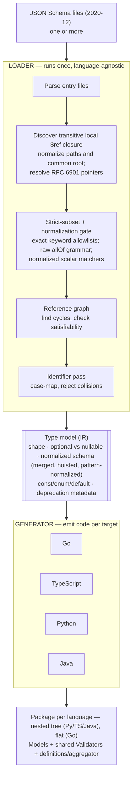
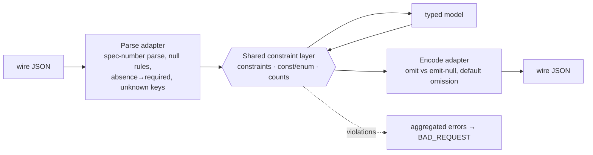

# Loader → Generator pipeline

A set of JSON Schema files becomes model code in four languages. The loader is
language-agnostic: it parses, enforces the strict subset, and lowers everything
to one shared type model. The generator emits that model for each target. The
per-file document concerns the Parse step decides first — the two file modes and
the `nexusrpc` / `$schema` root rules — live in [[input-files]]. See
[PRINCIPLES.md](PRINCIPLES.md) and `features/<keyword>.md` for detail.

*(Status: open — the JSON Schema front end takes the emitted target through
parse: inline-shape hoist naming, identifier validation and `x-<lang>-name`
selection all happen there, so the loader is re-run once per target and its
output already carries target-specific identifiers. Language-agnostic and
run-once is the contract; the front end is the defect. Closing it means
preserving every authored override through parse and selecting per target in a
later pass.)*

Parse begins from the explicitly supplied entry files. The loader follows local
`$ref` edges to a fixpoint, canonicalizes and deduplicates the discovered files,
then computes one common source root for the complete closure, bounded by the
invocation root ([[ref]]). Fragments are resolved as RFC 6901 JSON Pointers:
every token is decoded independently (`~0`/`~1`), including pointers through
nested `$defs`. A bare `#/` is not a synonym for the document root and is
rejected. Decoding happens **once**, here: what a later pass or a backend
receives is the decoded, module-qualified model name, and decoding it a second
time silently destroys any name that legitimately contains `~0`/`~1` — along
with every graph edge through it.

Each source in that closure marks its exported type declarations: its file-root
model when present, every referenced model in its `$defs` tree, and source-owned
models synthesized for inline operation inputs or outputs. This neutral
declaration metadata travels with the shared IR into reachability, and
**no shared pass infers a source's public surface from external-type kind** —
retention is driven by the declaration metadata alone. *(Status: open — the
reachability and emitted-name passes do still branch on the JSON external-type
kind for naming and traversal, so the stronger property, that no later shared
pass identifies JSON Schema declarations at all, does not hold, and nothing
mechanically stops a new pass from adding such a branch.)*

## Runtime validators

The JSON Schema constraint-planning layer represents the scalar predicate set
once—kind, numeric bounds, length, pattern, asserted format, `const`, and
`enum`. `contains`, `propertyNames`, ordinary field validation, and validation
of closed/default literals all consume that normalized description. Backends
still own syntax and native materialization, but they do not independently
choose which accepted assertions apply.

Every (de)serializer is three layers around one shared constraint layer. Sharing
is a requirement on the **predicate**, not on the call graph, and what the two
directions must share is the comparison *and its operand* — see **P12.2**, which
owns the rule. A predicate that counts wire keys on one side and decoded members
on the other is not shared however it is spelled, and it makes the aggregated
violation set direction-dependent, which **P11.1** forbids.

